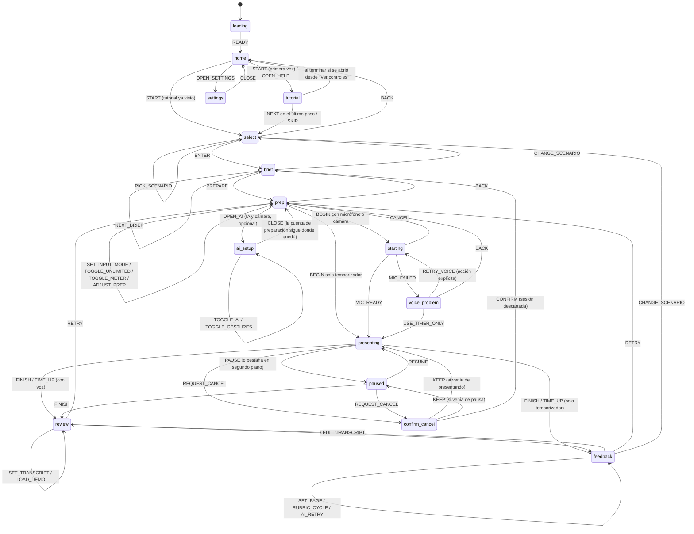

# Arquitectura y estados

Pensada para poder explicarse en clase: **la lógica no sabe nada de 3D** y la parte 3D no toma decisiones.

```text
                ┌──────────────────────────── js/core (lógica pura, probada en Node) ───────────────────────────┐
 config/*.js ──►│ state-machine.js  ──►  session.js  ──►  screens.js (modelo de pantalla)                       │
 (briefs,       │  tabla de estados      cronómetro,        qué se muestra y qué acciones hay en cada estado     │
  escenarios,   │  y transiciones        pausa, voz,                                                             │
  tiempos)      │                        devolución  ◄── metrics.js · feedback.js · rubric.js · time-warnings.js │
                └───────────────┬────────────────────────────────────────────────────────┬───────────────────────┘
                                │ eventos 'change', 'tick', 'warning'                    │ modelo de pantalla
                       ┌────────▼─────────┐                                   ┌───────────▼────────────┐
 voice/*.js  ◄────────► │  main.js         │                                   │  ui/ui-hub.js          │
 (voz, audio)           │  (cableado)      │                                   │  agrupa y avisa cambios│
                        └────────┬─────────┘                                   └───────┬────────┬───────┘
                                 │                                                     │        │
                     ┌───────────▼────────────┐                     ┌──────────────────▼──┐  ┌──▼───────────────────┐
                     │ components/ (A-Frame)  │                     │ ui/pitch-ui.js (3D) │  │ ui/html-overlay.js   │
                     │ stage-controller       │◄────────────────────│ panel, atril, reloj,│  │ panel de texto       │
                     │ walk-rig · xr-support  │                     │ brief, botones      │  │ accesible (HTML)     │
                     └───────────┬────────────┘                     └─────────────────────┘  └──────────────────────┘
                                 │ construye
                     ┌───────────▼────────────┐
                     │ scenes/ (geometría)    │  hub · sala · cliente · auditorio · público instanciado
                     └────────────────────────┘
```

## Separación de responsabilidades

| Pieza | Archivo(s) | Responsabilidad |
|---|---|---|
| **Escenas** | `js/scenes/*`, `js/components/stage-controller.js` | Construyen y liberan el espacio 3D según el estado. Un solo componente decide qué espacio mostrar. |
| **Sesión** | `js/core/session.js`, `state-machine.js` | Estados, transiciones, cronómetro, pausa, cancelación, voz y medición. |
| **Voz** | `js/voice/*` | Detección de capacidades, `SpeechController` (Web Speech API), `AudioMeter` (nivel de audio, opcional). |
| **Evaluación** | `js/core/metrics.js`, `feedback.js`, `rubric.js` | Métricas, indicador técnico orientativo, consejos y rúbrica. Funciones puras. |
| **Interfaz** | `js/core/screens.js`, `js/ui/*` | Un *modelo de pantalla* único que dibujan dos renderizadores: espacio 3D y panel de texto HTML. |
| **IA y cámara** | `js/ai/*` | Opcional. Graba el audio, lo analiza con la API de Gemini (clave de cada persona) y mide gestos de manos en el dispositivo con MediaPipe. Ver [`analisis-con-ia.md`](analisis-con-ia.md). |

## Diagrama de estados



Reglas que impone la tabla `FLOW` de `state-machine.js`:

- **Un evento que no figura en el estado actual se rechaza** (se emite `rejected`). Un botón de una pantalla
  anterior no puede alterar la sesión.
- `RESET` (reinicio limpio a Inicio) no se acepta durante una sesión activa (`starting`, `presenting`, `paused`,
  `confirm-cancel`): primero hay que cancelarla con confirmación.
- El test `screens.test.js` comprueba que **todo botón que muestra una pantalla envía un evento permitido
  en ese estado** y que hay a lo sumo **una acción principal** por estado.

## Temporizadores sin duplicados

`Session` tiene **un solo** `setInterval` (cada 200 ms) que se crea y se destruye en `_ensureTicker()` y
`_stopTickerIfIdle()`. Solo corre en *preparación* (mientras queda cuenta regresiva) y en *presentando*.

El tiempo efectivo **no se suma por ticks**: se calcula con marcas de reloj (`now - segmentStart`) y se acumula al
pausar. Por eso es exacto aunque el navegador demore los intervalos, y las pausas (y el diálogo de cancelación)
no cuentan. Tests: `session.test.js` («Nunca hay más de un temporizador activo», «El tiempo efectivo excluye las pausas»).

La preparación **no empieza la presentación sola**: al llegar a 0 se muestra «Preparación lista» y se espera la
acción explícita.

## Voz y medios

- `SpeechController.start()` se llama **de forma síncrona** dentro del gesto de la persona. Los resultados
  asíncronos se descartan si la sesión ya cambió de estado (`_voiceAttempt`), de modo que cancelar mientras se
  espera el permiso nunca deja una escucha iniciada.
- Si el navegador corta la escucha continua, se reinicia hasta `maxAutoRestarts` veces; si no se sostiene se avisa
  (`notifyVoiceLost`) y la presentación sigue solo con temporizador.
- `Session._teardownMedia()` libera voz y medidor al **cancelar, reintentar, reiniciar o salir** (`pagehide`). Solo
  libera lo que realmente se inició.

## Análisis con IA y cámara (opcional)

```text
Session ──► AnalysisService ──┬─► AudioCapture   MediaRecorder → WAV 16 kHz mono (solo en memoria)
                              ├─► GestureTracker MediaPipe (CPU) → GestureAccumulator → resumen de cifras
                              └─► GeminiClient   generateContent (JSON con esquema) → normalizeAnalysis → feedback.ai
```

- La Sesión solo conoce una interfaz pequeña (`startAudio`, `startCamera`, `beginTracking`, `pause`, `resume`,
  `finishCapture`, `analyze`, `abort`); en las pruebas se reemplaza por un falso controlable.
- Los permisos se piden de forma **síncrona dentro del gesto**, y un contador de generación suelta cualquier
  micrófono, cámara o modelo que llegue **después de cancelar** (ver `problemas-resueltos.md`, problema 10).
- El análisis corre **en segundo plano**: la devolución se muestra enseguida y la pestaña de IA pasa de «analizando» a
  «lista» o «error»; un resultado tardío de una sesión anterior se ignora (`_aiAttempt`).
- La grabación se conserva en memoria solo mientras el análisis falle y se pueda **reintentar**; se descarta al
  terminar, reintentar la práctica, cancelar o reiniciar.
- Ver [`analisis-con-ia.md`](analisis-con-ia.md) para privacidad, cuota, clave y limitaciones.

## Espacio 3D

- **Coordenadas**: el origen es el atril; la persona empieza 1,4 m detrás, mirando hacia -z, donde está el público.
- **Geometría liviana** con three.js directo (`Kit` en `scene-kit.js`): materiales y geometrías compartidas y
  liberadas juntas. Sin sombras dinámicas; sombras suaves de «mancha» instanciadas.
- **Público instanciado** (`audience.js`): asientos, cuerpos, cabezas y sombras son pocas mallas instanciadas; el
  movimiento ambiental actualiza ~20 veces por segundo y se apaga con «movimiento reducido».
- **Texto y botones del espacio**: lienzos 2D convertidos en textura (`CanvasSurface`) con Anton y Barlow reales; no se
  usan fuentes de texto de A-Frame (que se descargan de un CDN). Los símbolos se dibujan como formas.
- **Interacción**: el cursor de A-Frame (`rayOrigin: mouse`) en computadora y el componente `xr-ray` (target ray de
  WebXR + eventos `selectstart/selectend`) en VR. Ambos emiten `mouseenter`/`mouseleave`/`click` sobre las entidades
  con clase `.ui`.
- **Límites**: `walk-rig` limita el movimiento a zonas rectangulares con obstáculos (`constrainMove`, probado en
  `layouts.test.js`). En VR solo hay teletransporte a marcas fijas y botón «Recentrar».

### Modelos y ambientación

`scenes/audience.js` (público humano instanciado), `scenes/dressing.js` (pisos con textura, ventanas, puertas, afiches, zócalos, techo, parlantes,
haces de luz), `scenes/furniture.js` (atril, plantas, estantes) y `Kit.batch()` en `scene-kit.js` (funde detalles repetidos en una malla).
Detalle, presupuesto y mediciones: [`modelos-3d.md`](modelos-3d.md).

## Componentes de A-Frame

| Componente | Archivo | Función |
|---|---|---|
| `stage-controller` | `components/stage-controller.js` | Elige y reconstruye el espacio (hub/escenario) al cambiar el estado |
| `walk-rig` | `components/walk-rig.js` | Caminar con teclado, límites, teletransporte, recentrado, modo sentado, fundido |
| `xr-ray` | `components/xr-support.js` | Rayo de puntería por mano/control (target ray de WebXR) |

> Nota técnica: A-Frame evalúa las propiedades de un componente al registrarlo, por eso los componentes no usan
> *getters* (ver `docs/problemas-resueltos.md`, problema 1).

## Dónde extender

- **Un brief nuevo**: agregarlo a `config/briefs.js`.
- **Un escenario nuevo**: agregar su configuración en `config/scenarios.js` y una función `build…` en `scenes/` que
  devuelva `{ spawn, zones, obstacles, pads, anchors, entities, update }` (ver `sala.js`).
- **Una regla de devolución**: `core/feedback.js` (`buildTips`) y su test en `tests/unit/metrics.test.js`.
- **Otro modelo o proveedor de IA**: `js/ai/gemini-client.js` (misma forma: `analyze` y `testKey`) y la lista `ai.models` de `config/app-config.js`.
- **Más criterios de análisis**: `js/ai/analysis-prompt.js` (esquema + instrucciones + validación) y `buildAiSection` en `core/feedback.js`.
